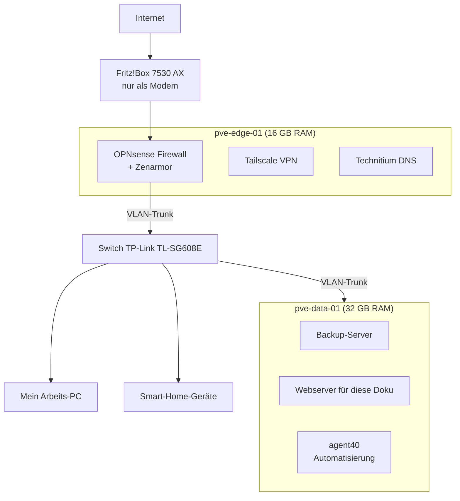

# Homelab: Proxmox, VLANs und eine abgeschottete Automatisierungs-VM

Ich mache gerade meine Qualifizierung zum Fachinformatiker für Systemintegration (IHK). Damit Netzwerk, Virtualisierung und Firewall für mich nicht nur Prüfungsstoff bleiben, habe ich mir zu Hause ein kleines Rechenzentrum aufgebaut: zwei Mini-PCs mit Proxmox, eine eigene Firewall und ein Netz, das in sechs Zonen aufgeteilt ist.

Angefangen hat alles mit einem flachen Netz (`10.10.10.0/24`), in dem alles mit allem reden konnte. Von dort aus habe ich das Lab in kleinen Etappen umgebaut, jeweils mit Backup vorher und einem Test danach. Diese Seite beschreibt den aktuellen Stand und was ich unterwegs gelernt habe.

Eine interaktive Übersicht mit allen Details gibt es hier: **[ttl1337.github.io/HomeLab](https://ttl1337.github.io/HomeLab/)**

## Aufbau



Firewall und Anwendungen laufen absichtlich auf getrennter Hardware. Wenn auf dem zweiten Server etwas ausfällt oder ich dort etwas falsch konfiguriere, bleiben Internet, DNS und VPN erreichbar. Umgekehrt kann ich am Edge-Server nur Dinge verändern, die mit dem Netzwerk zu tun haben.

### Hardware

| Gerät | Ausstattung | Aufgabe |
| --- | --- | --- |
| `pve-edge-01` – Lenovo ThinkCentre M720q Tiny | i5-8400T (6 Kerne, 35 W), 16 GB RAM, 256 GB NVMe + 128 GB SSD, Onboard-NIC plus PCIe-Dual-Port-Karte | Netzwerkrand: OPNsense, Tailscale und der interne DNS-Server |
| `pve-data-01` – Lenovo ThinkCentre M720q Tiny | i5-8400T, 32 GB RAM, 1 TB NVMe, 5-Port-SATA-Controller (JMicron JMB58x), eine NIC | Alles andere: Backup-Server, Webserver, Docker und `agent40` |
| TP-Link TL-SG608E | 8 Ports Gigabit, Easy Smart Managed | verteilt die VLANs per 802.1Q an Server und Endgeräte |
| AVM Fritz!Box 7530 AX | – | nur DSL-Modem und Transitnetz zur OPNsense; das eigentliche Netz liegt dahinter |

Der Edge-Server hat drei Netzwerkanschlüsse, die in Proxmox als eigene Bridges angelegt sind: `vmbr0` für das Management, `vmbr1` als WAN-Seite zur Fritz!Box und `vmbr2` als VLAN-Trunk zum Switch. Der Datenserver hat nur eine Netzwerkkarte. Über die laufen deshalb alle VLANs gleichzeitig als Trunk (`vmbr0`, VLAN-aware).

### Was wo läuft

| System | Typ | Host | VLAN |
| --- | --- | --- | --- |
| OPNsense mit Zenarmor | VM (2 vCPU, 8 GB RAM) | `pve-edge-01` | Gateway für alle |
| Tailscale Subnet Router | Debian-13-LXC, unprivilegiert | `pve-edge-01` | 10 |
| Technitium DNS (Zone `tre.internal`) | LXC | `pve-edge-01` | 10 |
| Proxmox Backup Server | LXC | `pve-data-01` | 20 |
| `homelab-site` (nginx, diese Doku) | Debian-13-LXC (1 vCPU, 256 MB RAM) | `pve-data-01` | 20 |
| Docker-Host | LXC | `pve-data-01` | 20 |
| `agent40` | Ubuntu-24.04-VM (2 vCPU, 2 GB RAM) | `pve-data-01` | 40 |

## Netzaufteilung

Statt eines einzigen Heimnetzes gibt es sechs VLANs. Die Regel dahinter: Geräte, denen ich weniger vertraue, kommen nur ins Internet und nicht an meine anderen Geräte.

| VLAN | Zone | Was dort läuft | Darf zugreifen auf |
| --- | --- | --- | --- |
| 10 | Management | Proxmox-Hosts, Switch, DNS, VPN | – |
| 20 | Services | Backup-Server, Webserver, Docker | – |
| 30 | Clients | mein Arbeits-PC, Laptop | Management, Services, NAS |
| 40 | Automation | `agent40` | nur Internet (DNS, HTTP/S, SMTP) |
| 50 | NAS | reserviert für späteren Speicherausbau | – |
| 60 | IoT | Hue Bridge, Kamera, Smart-TV | nur Internet |

Alle Netze sind `10.10.<VLAN>.0/24`, das Gateway ist jeweils die `.1` auf der OPNsense. Die Adressen verteilt Kea DHCP, als DNS-Server bekommen alle Clients den Technitium-Server. Neue Geräte trägt OPNsense per Dynamic DNS automatisch in die Zone `tre.internal` ein.

### Firewall-Regeln

Mein Ansatz ist eine Mischung aus Komfort und Abschottung:

- **VLAN 30 (Clients)** darf gezielt auf Management, Services und NAS zugreifen. Von hier aus verwalte ich alles.
- **VLAN 40 (Automation) und VLAN 60 (IoT)** haben eine Regel, die alle privaten Adressbereiche sperrt (`10.0.0.0/8`, `172.16.0.0/12`, `192.168.0.0/16`, als Alias `RFC1918`). Damit kommen sie auch nicht an die Fritz!Box.
- **VLAN 40** ist noch strenger. Erlaubt sind nur:
  - DNS (Port 53) zum eigenen DNS-Server,
  - HTTP (Port 80) für Paket-Updates,
  - HTTPS (Port 443) für die Gemini-API, OneDrive, Wetterdaten und GitHub,
  - SMTPS (Port 465) für den Mailversand.

  Alles andere wird verworfen und geloggt.

Per Tailscale komme ich von unterwegs in alle Netze. Tailscale läuft bewusst nicht auf der Firewall selbst, sondern in einem eigenen Container, weil sich Tailscale und Zenarmor auf der OPNsense gegenseitig gestört haben. Beim Umbau auf VLANs war das außerdem mein Notzugang, falls ich mich selbst aussperre.

### Switch-Ports

| Port | Gerät | Modus | PVID | Tagged |
| :---: | --- | --- | :---: | --- |
| 1 | `pve-edge-01`, Management-NIC | Access | 10 | – |
| 2 | `pve-data-01`, einzige NIC | Trunk | 10 | 20, 30, 40, 50, 60 |
| 3 | Arbeits-PC | Access | 30 | – |
| 4 | Hue Bridge | Access | 60 | – |
| 5 | Kamera / Smart-TV | Access | 60 | – |
| 6–7 | frei | deaktiviert | 99 | – |
| 8 | `pve-edge-01`, OPNsense-LAN-Trunk | Trunk | 10 | 20, 30, 40, 50, 60 |

Unbenutzte Ports liegen in VLAN 99. Das VLAN hat keinen Gateway und keine Regeln, wer dort ein Kabel einsteckt, landet also im Nichts.

## agent40: die Automatisierungs-VM

`agent40` ist eine Ubuntu-Server-VM ohne Oberfläche, die mit Hilfe der Gemini-API drei Berichte erstellt:

- eine Tagesübersicht mit Wetter (Open-Meteo) und Terminen,
- einen Homelab-Statusbericht (Backups, Auslastung, Auffälligkeiten der Firewall),
- Übungsfragen für die AP1/AP2, erzeugt aus meinen eigenen Lernnotizen.

Die Skripte laufen per `cron` und schreiben die Berichte als HTML-Datei. Der Versand per `msmtp` ist eingerichtet, es fehlen nur noch die echten Zugangsdaten.

### Zugriff auf die Lernnotizen

Meine Notizen liegen in Obsidian und werden zwischen PC und Laptop über OneDrive synchronisiert. Die VM braucht dafür weder Obsidian noch eine Oberfläche. Vor dem Lernbericht kopiert `rclone` genau einen Ordner auf die VM, und zwar nur lesend:

```bash
rclone sync onedrive:Apps/remotely-save/ObsidianTTL/30_Workspace /opt/vault-mirror/30_Workspace --include "*.md"
```

Damit kann die VM meine Notizen weder verändern noch löschen, der PC muss nicht laufen und private Ordner landen nie auf der VM.

### Warum VM und nicht Container

Die VM spricht mit mehreren externen Diensten und soll später Webhooks aus dem Internet bekommen. Deshalb habe ich sie als richtige VM mit eigenem Kernel angelegt und nicht als LXC, der sich den Kernel mit dem Host teilt. Zusätzlich ist IPv6 abgeschaltet, damit nichts an den IPv4-Firewallregeln vorbeiläuft.

### Updates per Webhook

Die VM holt sich ihre Skripte per `git pull` aus diesem Repository, mit einem Deploy-Key, der nur lesen darf. Damit das nach einem Push automatisch passiert, läuft auf der VM ein kleiner Node.js-Dienst (`webhook.service`), der nur auf `127.0.0.1:3000` lauscht. Er:

- prüft die HMAC-SHA256-Signatur von GitHub (`X-Hub-Signature-256`, Vergleich mit `crypto.timingSafeEqual`),
- lässt pro IP nur eine Anfrage alle 5 Sekunden durch (sonst `HTTP 429`),
- lehnt Anfragen über 1 MB ab (`HTTP 413`),
- bricht `git pull` nach 5 Sekunden ab.

Lokal habe ich alle drei Fälle getestet: falsche Signatur (`401`), zu viele Anfragen (`429`) und gültiger Push (`200` mit erfolgreichem Pull). Von außen soll GitHub die VM später über einen ausgehenden Tunnel (ngrok oder Cloudflare Tunnel) erreichen. Dann braucht es keine Portweiterleitung an der Fritz!Box oder der OPNsense.

## Backups

Alle VMs und Container beider Server sichert der Proxmox Backup Server, der als Container auf `pve-data-01` in VLAN 20 läuft. Er speichert doppelte Datenblöcke nur einmal, deshalb brauchen regelmäßige Vollsicherungen kaum zusätzlichen Platz. Die Systeme vom Edge-Server (OPNsense, Tailscale, DNS) landen damit auf dem anderen Gerät. Fällt `pve-edge-01` aus, sind die Backups also nicht mit weg. Für die Systeme auf `pve-data-01` läuft ein wöchentlicher Job (sonntags, die letzten vier Sicherungen bleiben erhalten).

Vor jedem größeren Umbau habe ich zusätzlich von Hand ein frisches Backup gemacht. Ehrlicherweise liegen Backup-Server und Datenserver aktuell noch auf derselben Hardware. Eine zweite Kopie außerhalb dieses Geräts gehört zum geplanten NAS-Ausbau.

## Die interaktive Übersicht

Die Seite unter [`site/index.html`](../site/index.html) ist eine einzelne HTML-Datei mit CSS und JavaScript, ohne Frameworks und ohne Build-Schritt. Sie hat fünf Ansichten:

- **Topologie:** der Netzplan zum Anklicken, mit Details zu jedem Gerät,
- **VLANs:** alle Zonen, Subnetze und Regeln,
- **agent40:** Berichte, Notiz-Spiegel und Webhook,
- **Troubleshooting:** Fehler aus dem Aufbau mit Ursache und Lösung,
- **Doku:** Hardware, Switch-Ports und Sicherheit im Detail.

Dieselbe Datei läuft öffentlich auf GitHub Pages und intern auf dem `homelab-site`-Container unter `http://map.tre.internal`. Der Container holt sich nur den Ordner `site/` aus dem Repository (`git sparse-checkout`), ebenfalls mit einem Deploy-Key, der nur lesen darf. SSH ist auf dem Container abgeschaltet, nginx läuft mit Security-Headern und ohne Versionsanzeige.

## Stand und nächste Schritte

Firewall, VLANs, Switch, VPN, DNS, Backups, Webserver und `agent40` sind in Betrieb. Offen sind noch:

- Die Berichte von `agent40` werden bisher nur lokal erzeugt. Der Versand per E-Mail ist vorbereitet, aber noch nicht eingerichtet.
- Der Tunnel, über den GitHub den Webhook erreicht, fehlt noch. Der Webhook selbst ist lokal getestet.
- Festplatten am SATA-Controller von `pve-data-01` einbinden und VLAN 50 als NAS in Betrieb nehmen. Dort soll dann auch eine zweite Backup-Kopie liegen.

## Über dieses Repository

Öffentlich sind nur diese Beschreibung und die interaktive Übersicht (`site/index.html`). Konfigurationen, Skripte und interne Notizen bleiben privat.

Host-Adressen sind hier nur bis auf die Netze angegeben, ausgeschrieben sind nur die Gateways (`.1`). Zugangsdaten, API-Keys, öffentliche IP-Adressen, Seriennummern und MAC-Adressen stehen nicht im Repository.
